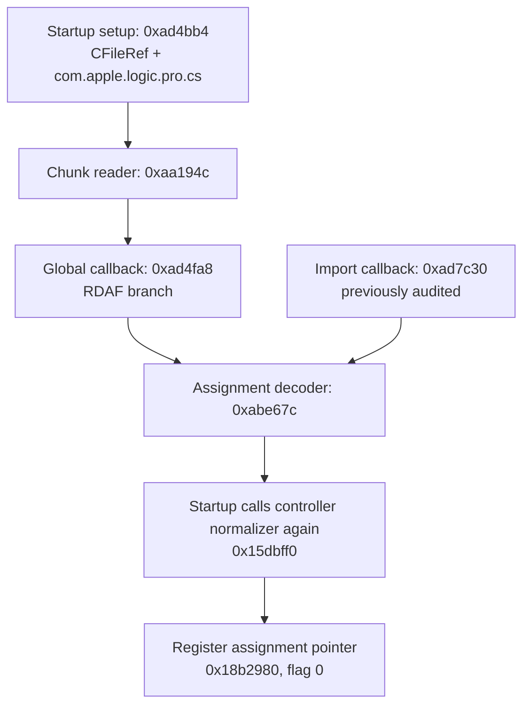

# ASSIGN-STARTUP-010: the copied assignment map also reaches startup loading

[Research guide](../README.md) · [JSON](assignment-startup-010.json) · [201 instruction/data/import anchors](../protocol/assignment-startup-12.4-anchors.tsv) · Previous: [CS reader endian gate](cs-reader-endian-gate-001.en.md), [ASSIGN-FIELDS-007](assignment-fields-007.en.md), [CS-INVENTORY-009](cs-assignment-inventory-009.en.md)

日本語要約：起動時の読み込みも、今回調べた割り当てデコーダーを使うことを接続した。処理中には `com.apple.logic.pro.cs` というファイル名が実際に指定される。読み込んだ割り当ては再度コントローラ参照を整えてリストへ登録される。タグ16が空ならUUID初期化処理が呼ばれるが、これはプラグインの識別データを持つタグ6とは別の保存先であり、対象確認の代わりには使えない。実機を起動した結果ではなく、保存バイナリの静的証拠である。

## Scope and route

Preserved Logic **12.4 / 6707**, SHA-256 `48862b9190f182b28bd87d7c8b15bd37516af58842debe52609c49ce5ed2bcda`. Curated instruction witnesses cover **348 bytes of caller excerpts** and **432 bytes of two small helpers**. The containing startup functions have `LC_FUNCTION_STARTS` intervals of 1012 and 4636 bytes; their other branches were excluded. Raw extraction/fixup scripts remain in ignored `Research/raw/rea/codex-assignment-startup-010/` with hashes in the JSON. No engine or target was started.

The application-startup caller link comes from CS-READER-001; this pass independently checks the filename, callback binding, RDAF branch and registration excerpt:

At `0xad4bf4–0xad4c04`, the file-reference global **0x26c1660** and a pointer to the exact string **`com.apple.logic.pro.cs` at 0x1da6a19** are passed to `0x19020c`. This 136-byte helper routes to imported `CFileRef::AddToPath`, `Set` or `ReplaceName` depending on `IsValid`, `IsFolder` and `CFURLHasDirectoryPath`; the boolean argument is zero. The setup tests imported `CFileRef::Exists()` and, on success, calls the chunk reader.

This establishes the requested **basename**, not the parent directory. The earlier helper `0x577090(fileRef, 8)` was not expanded, so the directory selector's meaning remains unproved here. No live file was opened.

## Callback and registration

The setup passes the block at **0x22ce2e8**. Its chained-fixup `isa` is `__NSConcreteGlobalBlock`, and its invoke pointer at **+0x10** rebases to **0xad4fa8**. The callback compares tag **0x46414452** and branches to `0xad5914`. Under mode 0 from CS-READER-001, this corresponds to file bytes **RDAF**.

The excerpt calls **`0xabe67c(reader, length)` at 0xad591c**. A non-null decoded assignment is kept in X19. The code then computes an index from a container's begin/end pointers, calls a preparation helper `0x18b25cc`, calls **`0x15dbff0` again**, and passes `(container, index, assignment, 0)` to **`0x18b2980`**. The preparation helper's internals and container ownership are not established by this excerpt.

The 296-byte registry setter stores the assignment pointer into **`container.begin[index]` at 0x18b29cc**. With the startup flag zero, it skips the branch that would call `0x15e194c` or tail-call `0x15e43f0`. This bounds the local startup path; it does not prove MIDI-device availability or actual message routing.

## The separate tag-16 token

Before storing the pointer, the setter compares assignment **+0x1e8/+0x1f0**, the begin/end of list 16. If empty, it requests 16 bytes through the existing list accessor and, if non-null, calls imported **`CUUIDBase::Init(uuidVersion)`** with raw enum argument **1**.

This is an initializer method, not a constructor; the enum argument is not assigned a UUID-standard version name. Its storage is distinct from list 6 (+0xf8), whose entry contains the plug-in identity and UUID. The historical four-row copy already has 16-byte tag 16 fields. A role as an assignment's own identifier is an **inference**, and tag 16 is not accepted as proof of a plug-in instance by the inventory tool.

## Verification and limits

The instruction bytes/text, basename, global-block bytes and 11 imported bindings were checked against independent Mach-O reads, LLVM and `dyld_info`; **201/201 anchors hold**. No product code or CI changed. The existing 26-test inventory checkpoint is reused; this documentation-only pass did not rerun it.

Still unknown: the exact parent-directory selection, device/port binding, every container-preparation side effect, current startup behavior and current target/value. The 007 normalizer proof remains scoped to the copied rows; other controller/pinned branches can have context effects. No new `verified` result is implied by startup registration.
